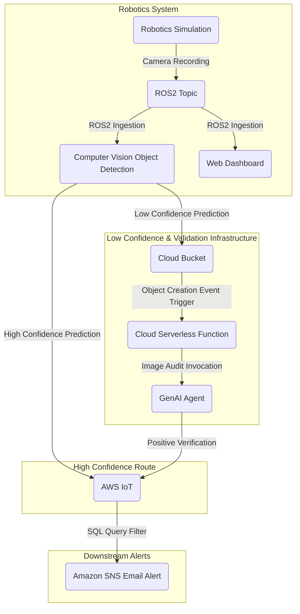

# Robotics Simulation + Vision and Cloud Integration

## System Overview

Robotics system designed for the mining industry integrated with cloud capabilities, detecting high-size rocks near trucks, notifying teams regarding their findings through email notifications. This system combines real-time computer vision with decentralized cloud and GenAI processes to execute predictions on the trucks while synchronizing visual evidence with dashboards to ensure continuous operational safety.

---

## In Engine Operation

The environment is a mining site where two trucks are parked, and near them are the rocks the robot is responsible for identifying.


---

## In-Engine Experience Video
Interacting within the environment.

[video](https://youtu.be/V5UWsdZAopY)

## Features

- **Real-Time Observability:** Streams raw camera topic metrics into a remote Foxglove Studio control room dashboard using WebSocket bridges for live site monitoring.
- **Decoupled Validation Engine:** Employs an independent GenAI layer to review lower-confidence data entries without hindering telemetry ingestion.
- **Structured Schema Enforcement:** Ensures type uniformity and property definitions across the data ingestion pipeline using explicit schema definitions.
---

## Data Flow



1. **Vision Retrieval:** The wheeled robot evaluates high-size rocks through a camera inside the simulation engine.
2. **Topic Subscription and Live Observability:** Frames are mapped into an active ROS2 topic via CvBridge. Simultaneously, the camera stream is pushed using a Foxglove bridge link to feed real-time visual frames straight to a **Foxglove** web platform.
3. **Inference Pipeline:** A custom-trained YOLO model processes and interprets the incoming visual frames. 
4. **Conditional Cloud Distribution:** 
   * **High Confidence:** If the frame predictions are above the designated high-confidence thresholds, the robot bypasses the GenAI Auditor and publishes the MQTT payload directly to **AWS IoT Core**.
   * **Low Confidence:** If the detection falls below the confidence threshold, the robot does *not* send an MQTT payload. Instead, it uploads the image exclusively to **Amazon S3** to kick off the external GenAI audit process.
5. **Auditing Verification:** The object creation event in Amazon S3 triggers an AWS Lambda function that invokes the **Agent Auditor** using a gpt-5-nano model via the OpenAI SDK. If the agent confirms that the image shows exactly a rock near a truck, the agent auditor itself sends the finalized MQTT payload directly to **AWS IoT Core**.
6. **Downstream Messaging:** **AWS IoT Core** validates the received MQTT payload (regardless of whether it originated directly from the robot or from the agent auditor) and filters it through an internal SQL query statement to issue email alerts via **Amazon SNS**.


---

## Data Structures

### AWS IoT Core Ingestion Payload
The system transmits the following payload format to **AWS IoT** upon discovering a positive target correlation (sent directly by the robot on high-confidence matches, or by the agent auditor upon successful verification):

```json
{
  "device_id": "wheeled_robot_01",
  "process_id": "a1b2c3d4-e5f6-7a8b-9c0d-1e2f3a4b5c6d",
  "element_type": "rock_near_truck",
  "alert_level": "warning",
  "timestamp": 1792101780,
  "prediction_confidence": 0.912
}
```

### AWS IoT SQL Query
SQL Statement to trigger the email notifications

```sql
SELECT * FROM 'robotics/vision_detections' WHERE prediction_confidence > 0.8
```

### GenAI LLM Agent Auditor Internal Prompt & Schema
The agent is explicitly structured around the following core execution logic:

```text
Audit target image. 
Output JSON format:
{
  "image_properly_predicted": true,
  "feedback": "The image effectively shows rocks near a truck.",
  "confidence": 0.901
}

Notes:
1. The "image_properly_predicted" field must be a strict JSON boolean (true/false).
2. The "feedback" field must be a concise, single-sentence analysis verifying the presence of a big rock near the vehicle.
3. The "confidence" field must be a 3-decimal float representing the model's statistical certainty and verification accuracy of the target image classification.
```

---

## Repository Architecture

This repository hosts two distinct, decoupled sub-projects working co-dependently to form the end-to-end intelligent automation solution.

### 1. Robotics Simulation
The core edge system running localized 3D rendering loops, sensory tracking topics, and immediate computer vision inferences.

```text
robotics_simulation/
├── cloud/
├── computer_vision/
│   ├── computer_vision_model/
│   └── vision_detection/
├── config/
├── core/
├── robotics/
├── scene/
│   ├── assets/
│   │   └── models/
│   └── schemas/
└── docs/
```

### 2. GenAI Agent Auditor
A standalone serverless cloud function that interfaces with cloud object store triggers and leverages a large language model to inspect and validate incoming captured images.

```text
agent_auditor/
├── config/
├── core/
├── prompts/
├── schemas/
├── services/
└── lambda_function.py
```

---

## Simulation Architecture

The tridimensional simulation workspace uses an asset loading configuration within the MuJoCo runtime workspace to track spatial bounds and calculate terrain collisions.

- **Scene Entrypoint (`scene.xml`):** Integrates the robot layout, declares external 3D reference paths (`.obj` meshes), loads textures, and maps coordinates for asset entities such as the trucks, the mountain and the rocks in the scene.

### Acknowledgments
This project was made possible by leveraging industry-leading tools and frameworks:
* AI & Logic: OpenAI for the development of GPT models and the OpenAI Python SDK for seamless agent integration.
* Engine & Interface: The MuJoCo Engine team for the core environment.

Project Link: [github.com](https://github.com/manuelftech/physical-ai-control)
