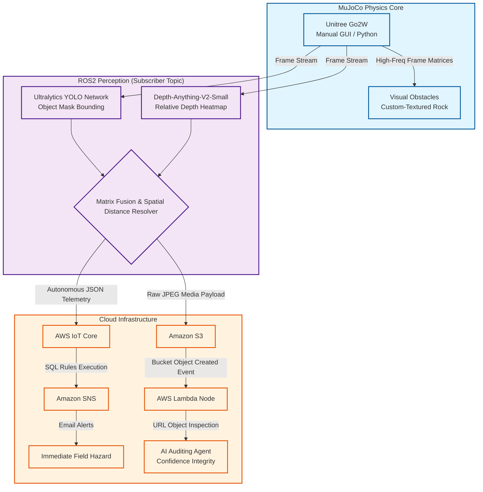

# Robotics Simulation + Computer Vision: Unitree Go2W

This architecture integrates real-time computer vision, physics-informed simulation, and cloud-native alerting pipelines to process visual data from a robotic workspace. Operating entirely without laser-based sensors, the system demonstrates how deep learning pipelines can achieve precise terrain classification and geometric distance mapping using purely visual data.

The system captures high-frequency image arrays via a camera mounted on a human-controlled **Unitree Go2W** platform inside a **MuJoCo** simulation. As the operator drives the vehicle, an automated edge-to-cloud perception framework dynamically processes the scene, evaluates target thresholds, and routes real-time telemetry to the cloud for autonomous safety auditing and immediate notification delivery.

---

## In Engine Operation

The core operational setup captures the Unitree Go2W traversing the simulated earth grid, tracking the custom stone boundary constraints via the manual GUI control array.


---

## Architecture Flow & Data Topology


---

## Data Pipeline Schemas

### Edge Perception Payload
Upon structural hazard recognition within the camera stream, the localization script automatically resolves target proximity and issues an explicit JSON string across the MQTT broker:

```json
{
  "object-detected": "Rock",
  "distance-meters": "1.5"
}
```

### AWS IoT Core Rule Evaluation
At the cloud gateway, structured SQL logic continuously evaluates incoming topic telemetry to isolate valid target alerts before interacting with alerting backends:

```sql
SELECT 
  `object-detected` AS object, 
  `distance-meters` AS distance 
FROM 
  'robotics/telemetry/rock_detection' 
WHERE 
  `object-detected` = 'Rock' 
  AND CAST(`distance-meters` AS DOUBLE) <= 2.0;
```

---

## Core Stack & Functional Intent

* **Unitree Go2W**: Serves as the core robotic testing vehicle utilizing programmatic Python wheel controls via an integrated GUI matrix to execute manual platform positioning.
* **MuJoCo Engine**: Manages the physics-informed rigid-body simulation environment, processing contact surfaces, custom high-resolution meshes, and camera feed streaming.
* **ROS2 (Robot Operating System)**: Acts as the low-latency communication middleware, distributing raw visual camera matrices from the operator-driven vehicle down to secondary calculation nodes.
* **Ultralytics YOLO (v8/v11)**: Runs on top of **PyTorch** to extract real-time object classification and multi-dimensional image bounding boxes for target hazards.
* **Depth-Anything-V2-Small**: Utilizes a vision transformer framework to generate relative monocular depth maps directly from incoming 2D video sequences.
* **Custom Sensor Fusion Algorithm**: A specialized Python matrix script that isolates spatial coordinates from YOLO's bounding data and correlates them with corresponding grayscale depth regions to calculate real-world distance vectors in meters.
* **AWS IoT Core**: Operates as the central message broker parsing streaming telemetry using localized SQL syntax to handle automated event routing.
* **Amazon S3**: Hosts raw image buffers dispatched from the edge perception script to build an asynchronous historical ledger.
* **AWS Lambda**: Launches serverless, python-driven execution hooks triggered directly by S3 media updates.
* **Asynchronous AI Agent**: Processes the raw image URLs within the Lambda function to inspect visual confidence thresholds and flag performance discrepancies.
* **Amazon SNS (Simple Notification Service)**: Handles alerting logistics, issuing immediate email updates to external recipients when safety criteria are met.
