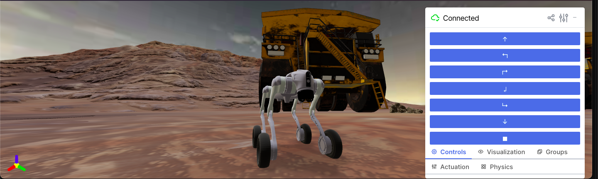
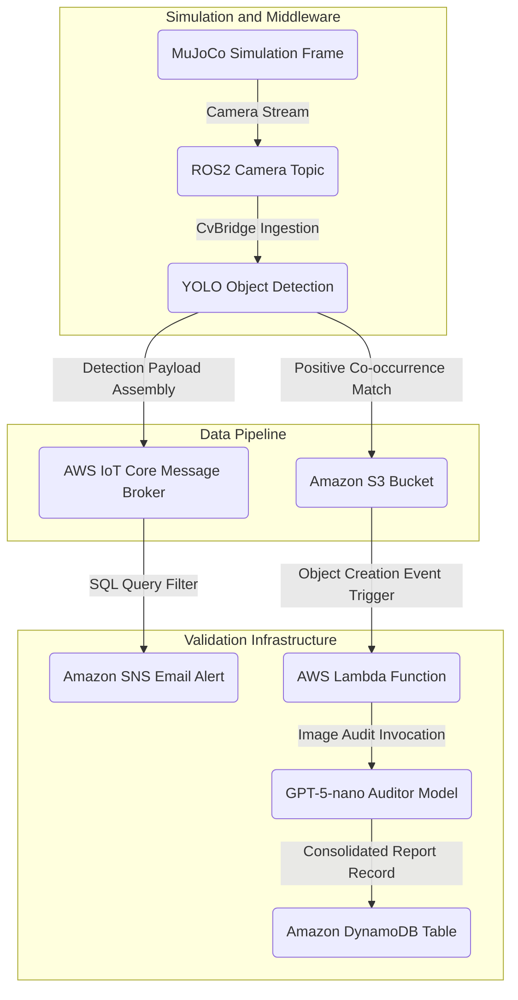

# Robotics + Vision and Cloud Integration

## System Overview

An agent-based data processing workflow designed for automated situational reporting on site. The system monitors designated zones to identify structural elements and geographical obstacles simultaneously, using a wheeled robot configuration. Data streams from physical simulation definitions, through a robotics middleware layer, into a cloud infrastructure for storage and validation.

The pipeline processes image streams from the robot camera, assesses specific object proximities, publishes validated operational flags to a message broker, and utilizes generative modeling to audit the consistency of downstream predictions.

---

## In Engine Operation

The workspace interface mounts a dual-pane runtime window to manage the locomotion and observation routines of the robot. 

The primary viewport displays the tridimensional simulation space populated with ground mesh elements, macro obstacles, and large-scale machinery assets. A floating telemetry control deck anchors to the side, exposing programmatic interface hooks for directional actuation coordinates, sensor visualization settings, scene physics parameters, and state status reporting.



---

## Features

- **Proximity Event Logging:** Captures co-occurrence events involving geographical elements and machinery assets from raw visual matrices.
- **Asynchronous Execution Buffering:** Implements standard polling delays within the notification loop to manage stream frequencies.
- **Decoupled Validation Engine:** Employs an independent compute layer to review data entries without hindering telemetry ingestion.
- **Structured Schema Enforcements:** Assures type uniformity and properties definition across the data ingestion pipeline using explicit schema definitions.

## Data Flow



1. **Vision Retrieval:** The Unitree Go2w robot simulation evaluates geographical fields near asset locations via its camera system.
2. **Topic Subscription:** Frames are mapped into an active ROS2 topic (`sensor_msgs/msg/Image`) via a bridge pipeline.
3. **Inference Pipeline:** A YOLO model trained for 100 epochs interprets the frames. If an operational asset and a boundary object appear within the same frame at designated thresholds, a synchronization flow activates.
4. **Cloud Distribution:** The original frame is uploaded directly to Amazon S3, generating an accessible URL address. Concurrently, telemetry data routes into AWS IoT Core.
5. **Downstream Messaging:** AWS IoT Core filters incoming events through an internal SQL query statement to issue email notifications via Amazon SNS.
6. **Auditing and Persistence:** An Amazon S3 object creation trigger invokes an AWS Lambda function. This function passes the stored asset to a `gpt-5-nano` model via the OpenAI SDK. The model checks the validity of the classification and writes the audit verification directly to an Amazon DynamoDB table (`AuditingMiningPredictions`).

## Data Structures

The system transmits the following payload format to the AWS IoT Core message broker upon discovering a positive target correlation:

```json
{
  "process_id": "a1b2c3d4-e5f6-7a8b-9c0d-1e2f3a4b5c6d",
  "element_type": "rock_near_truck",
  "alert_level": "warning",
  "timestamp": 1792101780,
  "image_url": "s3://audit-vision-detection/001.jpg",
  "prediction_confidence": 0.912
}
```

The resulting verification record updated in the `AuditingMiningPredictions` table inside Amazon DynamoDB contains the structural schema below:

```json
{
  "process_id": "a1b2c3d4-e5f6-7a8b-9c0d-1e2f3a4b5c6d",
  "audit_timestamp": 1792101785,
  "verification_status": "PROCESSED_SUCCESSFULLY",
  "model_feedback": "The image effectively shows rocks near a truck.",
  "s3_reference_path": "s3://audit-vision-detection/001.jpg"
}
```

## Folder Structure

```text
physical-ai-control/
├── config/
│   ├── __pycache__/
│   ├── config_nvidia.py
│   ├── config_vars.py
│   └── logger.py
├── docs/
├── src/
│   ├── cloud/
│   │   ├── aws_iot.py
│   │   └── aws_s3.py
│   ├── computer_vision/
│   │   ├── computer_vision_model/
│   │   ├── resource/
│   │   ├── test/
│   │   └── vision_detection/
│   ├── core/
│   │   └── utils.py
│   ├── robotics/
│   │   ├── __pycache__/
│   │   ├── interface_config.py
│   │   ├── movement_config.py
│   │   └── robotics_simulation.py
│   ├── scene_3d/
│   │   ├── assets/
│   │   │   └── models/
│   │   │       ├── board_square/
│   │   │       ├── board_triangle/
│   │   │       ├── cone_warning/
│   │   │       ├── ground_rocks/
│   │   │       ├── ground_terrain/
│   │   │       ├── rock_brown/
│   │   │       └── truck_dumper/
│   │   ├── go2w.xml
│   │   ├── scene_terrain.xml
│   │   ├── scene.xml
│   │   └── terrain_rocks.xml
│   └── schemas/
│       └── detection_payload.py
├── training/
├── .dockerignore
├── .env
├── .gitignore
├── Dockerfile
├── README.md
├── requirements.txt
└── setup_server.sh
```

## Simulation Configuration

The physics definitions establish the tridimensional spatial tracking layout, rendering characteristics, and collision hulls within the MuJoCo runtime workspace.

## Simulation Architecture

The tridimensional simulation workspace uses a multi-layered asset loading configuration within the MuJoCo runtime workspace to track spatial bounds and calculate terrain collisions.

- **Scene Entrypoint (`scene.xml`):** Integrates the Unitree Go2w kinematics layout, declares external 3D reference paths (`.obj` meshes), mounts texture descriptors, and maps coordinates for asset entities (`truck_dumper_1` and `rock_brown_1`).
- **Terrain Subcomponent Asset Assembly (`terrain_rocks.xml`):** Segregates position vectors for low-profile landscape boundaries underneath the equipment models and the primary driving boundaries.
- **Visual Capture Parameters:** Headless rendering routines utilize forced lighting distributions and fixed pixel matrix shapes to preserve uniformity for the vision pipeline.