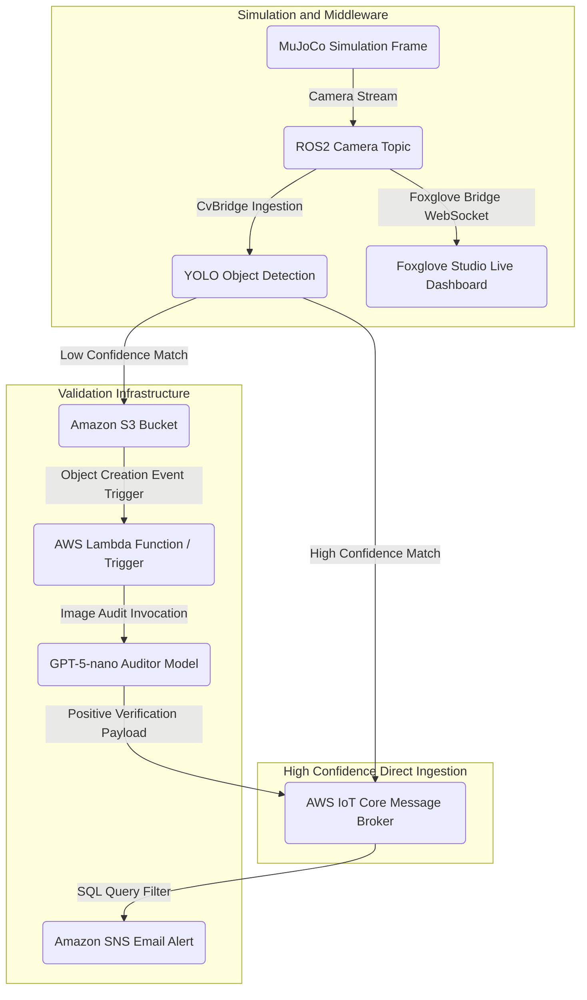

# Robotics Simulation + Vision and Cloud Integration

## System Overview

An agent-based data processing workflow designed for automated situational reporting on site. The system monitors designated zones to identify structural elements and geographical obstacles simultaneously, using a wheeled robot configuration. Data streams from physical simulation definitions, through a robotics middleware layer, into a cloud infrastructure for storage and validation.

The pipeline processes image streams from the robot camera, routes real-time telemetry to an operations dashboard, and assesses specific object proximities. If a detection falls below a high-confidence threshold, an independent asynchronous generative agent auditor validates the visual metrics, handles verification reporting, and routes confirmed alert signatures directly back into the primary communication stream.

---

## In Engine Operation

The workspace interface mounts a dual-pane runtime window to manage the locomotion and observation routines of the robot. 

The primary viewport displays the tridimensional simulation space populated with ground mesh elements, macro obstacles, and large-scale machinery assets. A floating telemetry control deck anchors to the side, exposing programmatic interface hooks for directional actuation coordinates, sensor visualization settings, scene physics parameters, and state status reporting.


---

## Features

- **Proximity Event Logging:** Captures co-occurrence events involving geographical elements and machinery assets from raw visual matrices.
- **Real-Time Observability and RoboOps:** Streams raw camera topic metrics into a remote **Foxglove Studio** control room dashboard using high-performance WebSocket bridges for live site monitoring.
- **Asynchronous Execution Buffering:** Implements standard polling delays within the notification loop to manage stream frequencies.
- **Decoupled Validation Engine:** Employs an independent compute layer (`agent_auditor`) to review lower-confidence edge-case data entries without hindering telemetry ingestion.
- **Structured Schema Enforcements:** Assures type uniformity and properties definition across the data ingestion pipeline using explicit schema definitions.

---

## Data Flow



1. **Vision Retrieval:** The Unitree Go2w robot simulation evaluates geographical fields near asset locations via its camera system.
2. **Topic Subscription and Live Observability:** Frames are mapped into an active ROS2 topic (`sensor_msgs/msg/Image`) via a bridge pipeline. Simultaneously, the camera stream is multiplexed and pushed natively over a WebSocket interface using a `foxglove_bridge` link to feed real-time visual frames straight to a localized **Foxglove Studio** platform.
3. **Inference Pipeline:** A YOLO model trained for 100 epochs interprets the frames. 
4. **Conditional Cloud Distribution:** 
   * **High Confidence:** If an operational asset and a boundary object appear within the same frame above designated high-confidence thresholds, the robot bypasses the auditor and publishes the MQTT payload directly to **AWS IoT Core**.
   * **Low Confidence:** If the detection falls under the confidence threshold, the robot does *not* send an MQTT payload. Instead, it uploads the image exclusively to **Amazon S3** to kick off the external audit process.
5. **Auditing Verification:** The **Agent Auditor** analyzes the uploaded asset from S3 using a `gpt-5-nano` model via the OpenAI SDK. If the agent confirms with high certainty that the image shows exactly a rock near a truck, the agent auditor itself compiles and sends the finalized MQTT payload directly to **AWS IoT Core**.
6. **Downstream Messaging:** **AWS IoT Core** validates the received MQTT payload (regardless of whether it originated from the robot or the agent auditor) and filters it through an internal SQL query statement to issue email alerts via **Amazon SNS**.

---

## Data Structures

### AWS IoT Core Ingestion Payload
The system transmits the following payload format to the **AWS IoT Core** message broker upon discovering a positive target correlation (sent directly by the robot on high-confidence matches, or by the agent auditor upon successful verification):

```json
{
  "process_id": "a1b2c3d4-e5f6-7a8b-9c0d-1e2f3a4b5c6d",
  "element_type": "rock_near_truck",
  "alert_level": "warning",
  "timestamp": 1792101780,
  "prediction_confidence": 0.912
}
```

### Agent Auditor Internal Prompt & Schema
The agent is explicitly structured around the following core execution logic:

```text
Audit target image. 
Output JSON format:
{
  "image_properly_predicted": true,
  "feedback": "The image effectively shows rocks near a truck.",
  "confidence": 0.901
}

Notes:
1. The "image_properly_predicted" field must be a strict JSON boolean (true/false).
2. The "feedback" field must be a concise, single-sentence analysis verifying the presence of a big rock near the vehicle.
3. The "confidence" field must be a 3-decimal float representing the model's statistical certainty and verification accuracy of the target image classification.
```

---

## Folder Structure

```text
physical-ai-control/
├── agent_auditor/
│   ├── config/
│   │   ├── aws_iot.py
│   │   ├── aws_s3.py
│   │   ├── config_vars.py
│   │   ├── logger.py
│   │   └── openai_agent.py
│   ├── prompts/
│   │   └── one_shot_image_auditor.txt
│   ├── schemas/
│   │   └── detection_payload.py
│   ├── .env
│   ├── agent_auditor.py
│   └── requirements.txt
├── docs/
│   ├── In-engine-image.png
│   └── server-construction.sh
├── robotics_simulation/
│   ├── cloud/
│   │   ├── aws_iot.py
│   │   └── aws_s3.py
│   ├── computer_vision/
│   │   ├── computer_vision_model/
│   │   ├── resource/
│   │   ├── test/
│   │   └── vision_detection/
│   ├── config/
│   │   ├── config_nvidia.py
│   │   ├── config_vars.py
│   │   └── logger.py
│   ├── core/
│   │   └── utils.py
│   ├── robotics/
│   │   ├── interface_config.py
│   │   ├── movement_config.py
│   │   └── robotics_simulation.py
│   ├── scene_3d/
│   │   ├── assets/
│   │   │   └── models/
│   │   │       ├── board_square/
│   │   │       ├── board_triangle/
│   │   │       ├── cone_warning/
│   │   │       ├── ground_rocks/
│   │   │       ├── ground_terrain/
│   │   │       ├── rock_brown/
│   │   │       └── truck_dumper/
│   │   ├── go2w.xml
│   │   ├── scene_terrain.xml
│   │   ├── scene.xml
│   │   └── terrain_rocks.xml
│   └── schemas/
│       └── detection_payload.py
├── training/
├── .dockerignore
├── .env
├── .env.template
├── .gitignore
├── Dockerfile
├── README.md
└── requirements.txt
```

---

## Simulation Configuration

The physics definitions establish the tridimensional spatial tracking layout, rendering characteristics, and collision hulls within the MuJoCo runtime workspace.

---

## Simulation Architecture

The tridimensional simulation workspace uses a multi-layered asset loading configuration within the MuJoCo runtime workspace to track spatial bounds and calculate terrain collisions.

- **Scene Entrypoint (`scene.xml`):** Integrates the Unitree Go2w kinematics layout, declares external 3D reference paths (`.obj` meshes), mounts texture descriptors, and maps coordinates for asset entities (`truck_dumper_1` and `rock_brown_1`).
- **Terrain Subcomponent Asset Assembly (`terrain_rocks.xml`):** Segregates position vectors for low-profile landscape boundaries underneath the equipment models and the primary driving boundaries.
- **Visual Capture Parameters:** Headless rendering routines utilize forced lighting distributions and fixed pixel matrix shapes to preserve uniformity for the vision pipeline.
